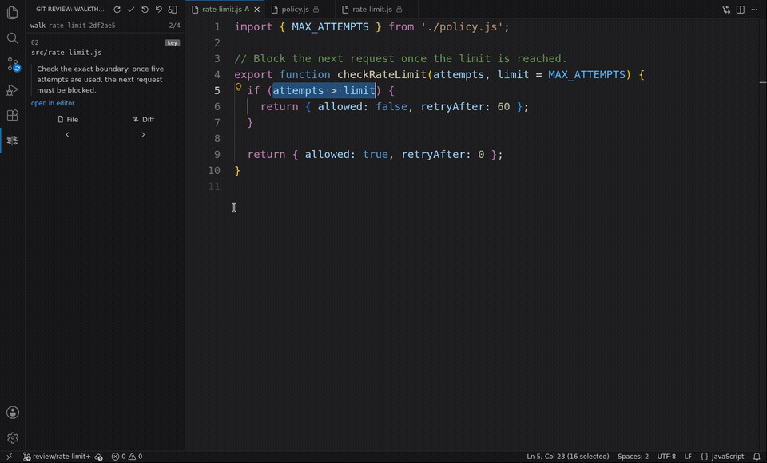

# git-review-workflow

> Revisá los pull requests de agentes con un **orden de lectura guiado**: qué
> archivo leer primero, por qué cambió y dónde mirar con atención. El autor o un
> agente puede commitear un walkthrough junto con el cambio; también podés
> preparar el tuyo para un PR que no tenga uno.
>
> Seguí el cambio completo en tu editor habitual. El PR queda como un único
> **diff staged y editable** que podés ejecutar y probar. Al terminar, tus
> correcciones se extraen a una rama aparte. Re-revisá solo lo que cambió después
> de una actualización.

[](LICENSE)
[](https://github.com/EzeVillo/git-review-workflow/releases)

[English](README.md) · **Español** · [Sitio web](https://git-review.ezevillo.com/)

Empezá desde su panel de VS Code, JetBrains o Visual Studio, o usá la interfaz de
terminal. Esas interfaces guían el flujo y dejan la [CLI](CLI.es.md) disponible
para scripts y usos avanzados.



**[Mirá la demo de 40 segundos en la web](https://git-review.ezevillo.com/#demo-vscode)** — seguí el orden de lectura,
corregí el código, corré los tests y llevate tu corrección a una rama aparte.

[Leé la guía: revisar un pull request localmente](https://git-review.ezevillo.com/es/guias/revisar-pull-requests-localmente/) — desde el primer diff staged hasta tus propias correcciones.

---

Un PR puede tocar muchos archivos sin decirte por dónde empezar. Un walkthrough
aporta un orden de lectura, un motivo por entrada y un heads-up sobre lo que
merece atención. Seguilo en tu editor, inspeccioná el código fuera del diff y dejá
observaciones. Podés usar el recorrido del autor o preparar el tuyo para esa
revisión.

El PR completo sigue disponible como **cambios staged sin commitear**. Corré los
tests o editá el código cuando necesites comprobar algo. Al terminar, las
ediciones que hayas hecho se extraen a una rama aparte. Una revisión también
puede terminar sin correcciones de código. Después de una actualización, podés
volver a revisar solo lo que cambió.

## Revisar lo que escribió un agente

Le pediste una feature a un agente. Volvió con catorce archivos cambiados y un
diff ordenado alfabéticamente — el único orden que garantiza no decir nada sobre
el cambio. Revisar eso es reconstruir, archivo por archivo, un razonamiento que
nunca viste.

Como parte de la misma tarea, el agente puede documentar el cambio que quiso
hacer en un walkthrough: un orden para los archivos cambiados, por qué importa
cada uno y qué merece atención. Esa explicación viaja con el PR para que la
contrastes con la implementación.

Después abrís la review en uno de los clientes visuales. El cliente encuentra el
walkthrough solo, muestra el heads-up del agente sobre qué es delicado y te lleva
al primer archivo con su explicación. Las entradas esenciales aparecen marcadas
como clave y el panel recorre el resto del orden. Todo el PR sigue staged y
editable, así que corregís inline lo que encontrás y terminás con tus
correcciones en una rama aparte.

Para que salga automático, poné esta instrucción donde tu agente la vaya a leer
— su `AGENTS.md`, su `CLAUDE.md` o tu template de prompt:

> Después de hacer y commitear el cambio, agregá un walkthrough de lectura al
> PR. Ordená los archivos cambiados, escribí un *por qué* de una línea para cada
> uno, incluí un heads-up con lo delicado, marcá las pocas entradas que un
> reviewer no puede leer por arriba, validá el walkthrough y committealo junto
> con el código.

Lo que queda es un archivo Markdown committeado, así que también se lee tal cual
en GitHub para cualquiera que nunca instale esto. Y conseguís lo mismo **sin que
el autor se suba**: en un PR que no trae walkthrough, el panel te ayuda a pedirle
a tu propio agente que genere uno solo para tu review.

El orden de lectura te ayuda a recorrer el cambio, tanto si la revisión termina
en observaciones como en una pregunta para el autor o una corrección. Cuando
necesitás comprobar un comportamiento, ejecutá el código en el mismo working
tree y hacé una edición si te resulta útil.

## ¿Por qué no usar la vista de PR de tu IDE?

git-review-workflow combina un **orden de lectura guiado y contexto** con el PR
completo y editable en tu working tree. Seguí la explicación, inspeccioná la
implementación y dejá observaciones. Si hacés correcciones, las separa del
trabajo del autor al terminar.

|                                  |     Ver el PR      | Orden guiado + por qué, por archivo | Editar y correr como working tree | Extraer tus fixes automáticamente | Re-review incremental | Independiente del editor |
|----------------------------------|:------------------:|:-----------------------------------:|:---------------------------------:|:---------------------------------:|:---------------------------------:|:------------------------:|
| **git-review-workflow**          |         ✅          |                  ✅                  |                 ✅                 |                 ✅                 |                 ✅                 |            ✅             |
| `gh pr checkout` / `glab`        | ⚠️ checkout pelado |                  ❌                  |                 ✅                 |                 ❌                 |                 ❌                 |            ✅             |
| JetBrains *Review Pull Request*  |         ✅          |                  ❌                  |         ⚠️ solo en el IDE         |                 ❌                 |                 ❌                 |            ❌             |
| Extensión *GitHub PR* de VS Code |         ✅          |                  ❌                  |         ⚠️ solo en el IDE         |                 ❌                 |                 ❌                 |            ❌             |
| Web de GitHub / GitLab           |         ✅          |                  ❌                  |                 ❌                 |                 ❌                 |            ⚠️ parcial             |            ✅             |

El **recorrido de lectura** agrega al diff un orden y un motivo por entrada. El
autor (a menudo un agente de IA) puede escribirlo y commitearlo junto con el PR.
El panel del reviewer lo detecta solo y presenta los archivos en ese orden.
No necesitás que el autor o tu equipo lo adopten primero: el panel te ayuda a
preparar tu propio orden de lectura para una review puntual.

Como el PR son cambios staged, las herramientas que leen un diff de Git pueden
inspeccionarlo entero. También podés pedirle a un agente que revise ese diff o
te ayude a comprobar una observación concreta ahí mismo.

Cuando decidís corregir un typo, un nombre o un comportamiento, editalo con tus
herramientas habituales. La extracción automática mantiene esas correcciones
separadas. También podés dejar una observación para que el autor haga el cambio.
La revisión guiada es útil sin editar código.

## Inicio rápido

Todas las interfaces manejan la misma CLI, así que instalala primero:

```sh
npm install -g git-review-workflow
```

Después elegí la interfaz desde la que querés trabajar:

| Interfaz | Empezá acá |
|----------|-------------|
| **VS Code** | [Instalá la extensión y abrí el panel de git review](https://marketplace.visualstudio.com/items?itemName=EzeVillo.git-review-workflow) |
| **IDE de JetBrains** | [Instalá el plugin y abrí la ventana de git review](https://plugins.jetbrains.com/plugin/33490-git-review-workflow) |
| **Visual Studio** | [Instalá la extensión y abrí el panel Git Review](https://marketplace.visualstudio.com/items?itemName=EzeVillo.gitreviewworkflow) |
| **Interfaz de terminal** | [Instalá y abrí la interfaz de terminal](tui/README.md) |

En un panel o en la interfaz de terminal, configurá una vez la rama base y elegí
**Start a review**. La interfaz te pregunta qué rama revisar y cómo recorrerla.
Editá y corré el cambio staged con tus herramientas habituales; después elegí
**Finish** para extraer tus correcciones a una rama aparte.

Las comparaciones ofrecen sólo comentarios Local y los conservan automáticamente al cerrarlas. Los formularios omiten el selector de destino cuando la CLI permite una sola opción.

Las notas Local son privadas; los comentarios Shared se preparan para el PR. Ambos
documentos conviven y el destino sólo se aplica al comentario nuevo. Si se pregunta
si querés continuar una review anterior, elegís si recuperar sus notas Local o
mantenerlas separadas. Shared viene de la rama actual en ambos casos.

Desde la CLI, `git review comments add --document local` abre tu editor Git para
una observación privada; elegí `--document shared` para prosa destinada al PR.
Ambos documentos siguen siendo Markdown editable fuera del working tree durante
la revisión. `finish` deja el Shared modificado como `.review/comments.md` en
la rama de salida, staged junto con tus correcciones y listo para commitear.
Después se elimina la preparación privada de Shared. Save/Continue la conserva
hasta Finish, incluidos los comentarios borrados. Undo la devuelve a la review;
Cancel descarta esa pasada y respeta los comentarios originales de la rama.
Fuera de una review, Comments está entre Walkthrough y Compare y lee Shared de
la rama actual, incluso en un clon nuevo. Los comentarios heredados de un PR
integrado no se copian a una review nueva. Agregar comentarios requiere una sesión activa.
Los comentarios Local siguen privados. **Copy path** copia la ruta absoluta de un documento
Local existente desde su fila del panel, incluidos los resultados conservados. Ver [comentarios de revisión](CLI.es.md#comentarios-de-revisión)
para renumerar, consultar diffs históricos y conservar comentarios de comparación
localmente.

Los formularios de comentarios de los IDE ofrecen el fragmento exacto seleccionado, archivo actual y General, con el alcance más específico disponible seleccionado. Podés cambiarlo antes de guardar. Las preparaciones Local y Shared existentes aparecen por separado y se pueden eliminar durante la review. Los resultados Local siguen siendo editables después de Finish.

El formulario identifica explícitamente el campo del comentario. El explorador de
Diff muestra una ubicación compacta y un fragmento de una línea, con `…` cuando
se recorta. El comentario completo se desplaza debajo; los identificadores de
revisión quedan plegados en Details y los avisos sobre capturas sin guardar
siguen visibles. Los diffs se abren dentro del IDE y el comentario queda accesible.
En terminal, `d` alterna Details y Tab vuelve al comentario completo. Las líneas
seleccionadas se marcan sobre la versión registrada. Local conservado y las
preparaciones Shared pendientes se pueden borrar después de Finish; Shared
entregado se lee de `.review/comments.md`.

El explorador de comentarios también permite borrar un comentario individual sin
cambiar los demás ni sus números. Los comentarios generales no ofrecen un diff.

## Instalación

Los clientes visuales comparten una pequeña base de línea de comandos. El
[Inicio rápido](#inicio-rápido) de arriba ya cubre la instalación por npm;
descolapsá abajo para Homebrew, el instalador nativo de Windows o una opción sin
Node.

<details>
<summary>Métodos de instalación (npm, Homebrew, Windows, en una línea, PATH)</summary>

Elegí el método que mejor te quede. Las opciones por gestor de paquetes son las
más fáciles y **te configuran el `PATH` solas**.

### npm (recomendado)

Si tenés [Node.js](https://nodejs.org), esta es la instalación de un solo comando.
Te pone `git review` en el `PATH` y anda en Linux, macOS y Windows (en Windows los
comandos igual corren bajo Git Bash):

```sh
npm install -g git-review-workflow
```

Actualizá con `npm install -g git-review-workflow@latest`; desinstalá con
`npm uninstall -g git-review-workflow`. El autocompletado se configura igual que
en las otras instalaciones que no son Homebrew — mirá la nota más abajo.

### Homebrew (macOS / Linux)

```sh
brew tap EzeVillo/git-review-workflow https://github.com/EzeVillo/git-review-workflow
brew install EzeVillo/git-review-workflow/git-review-workflow
```

El autocompletado queda configurado automáticamente. Para actualizar a la última
versión: `brew upgrade git-review-workflow`.

### Windows (PowerShell)

Necesitás [Git for Windows](https://gitforwindows.org), que provee la shell
donde corren estos comandos. Abrí PowerShell y ejecutá:

```powershell
irm https://raw.githubusercontent.com/EzeVillo/git-review-workflow/main/web-install.ps1 | iex
```

Instala el comando en `~\.local\bin` y agrega esa carpeta al `PATH` de tu usuario
automáticamente. Abrí una terminal nueva cuando termine. Volvé a correrlo para
actualizar; para desinstalar:

```powershell
irm https://raw.githubusercontent.com/EzeVillo/git-review-workflow/main/web-uninstall.ps1 | iex
```

(Si tenés Node, `npm install -g git-review-workflow` también anda en Windows — los
comandos igual corren bajo Git Bash en ambos casos.)

### Instalación en una línea (Linux, macOS, WSL, Git Bash)

¿Sin gestor de paquetes? Esto descarga el comando y lo instala en `~/.local/bin`
— ni siquiera necesitás clonar el proyecto antes:

```sh
curl -fsSL https://raw.githubusercontent.com/EzeVillo/git-review-workflow/main/web-install.sh | sh
```

Volvé a correrlo para actualizar (siempre instala la última versión). Para
desinstalar (pasale el mismo `PREFIX` si lo cambiaste):

```sh
curl -fsSL https://raw.githubusercontent.com/EzeVillo/git-review-workflow/main/web-uninstall.sh | sh
```

<details>
<summary>Desde una copia descargada</summary>

Si clonaste o descargaste el proyecto, abrí su carpeta en una terminal y corré:

```sh
./install.sh
```

Instala el dispatcher `git review` en `~/.local/bin` (cambiá la ubicación con
`PREFIX=/usr/local/bin ./install.sh`). Los verbos viajan al lado suyo como
helpers privados, no como comandos sueltos en tu `PATH`. Lo deshacés cuando
quieras con `./uninstall.sh`. Para actualizar, simplemente hacé `git pull` dentro
del repo — el symlink toma los cambios automáticamente.
</details>

<details>
<summary>"command not found" — agregar <code>~/.local/bin</code> a tu PATH</summary>

Tu `PATH` es la lista de carpetas donde tu terminal busca cuando escribís un
comando. Homebrew, npm y el instalador de PowerShell agregan su carpeta por vos. La
instalación en una línea y la manual usan `~/.local/bin`, que en la mayoría de
los sistemas ya está en el `PATH`. Si no lo está, el instalador te deja un aviso
— agregalo **una sola vez** pegando una línea en el archivo de config de tu
shell:

| Si tu terminal usa…                 | Agregá esta línea al archivo…        | La línea a agregar                     |
|-------------------------------------|--------------------------------------|----------------------------------------|
| **bash**                            | `~/.bashrc`                          | `export PATH="$HOME/.local/bin:$PATH"` |
| **zsh** (default en macOS reciente) | `~/.zshrc`                           | `export PATH="$HOME/.local/bin:$PATH"` |
| **fish**                            | *(sin archivo — corré esto una vez)* | `fish_add_path ~/.local/bin`           |

¿No sabés cuál usás? Corré `echo $0`. Después de editar el archivo, **abrí una
terminal nueva** (o hacé `source` del archivo). Tu cliente visual ya puede
encontrar la CLI.
</details>

<details>
<summary>Git Bash en Windows — ¿error de SSL al instalar?</summary>

Si ves `schannel: next InitializeSecurityContext failed` o un mensaje de
`revocation check`, tu Git for Windows está usando el backend SSL de Windows.
Arreglalo una vez y volvé a correr el instalador:

```sh
git config --global http.sslBackend openssl
```

</details>

</details>

## Referencia de la CLI

Los paneles y la interfaz de terminal cubren el flujo normal. Para consultar
todos los comandos, flags, caminos de recuperación y flujos avanzados, mirá la
[referencia completa de la CLI](CLI.es.md).

## Requisitos

- Git 2.23+. Se recomienda Git 2.38+ para obtener la comparación más precisa
  cuando un PR incorpora contenido de su rama base.
- Un remoto de Git configurado.
- Una shell POSIX. En Linux y macOS es la de por defecto. En Windows los comandos
  corren bajo Git Bash o WSL, no en `cmd.exe` ni PowerShell.

## Contribuir

Reportes de bugs, fixes e ideas son bienvenidos. Mirá
[CONTRIBUTING.md](CONTRIBUTING.md) para cómo correr los tests y el proceso de
release.

## Licencia

[MIT](LICENSE) © EzeVillo
