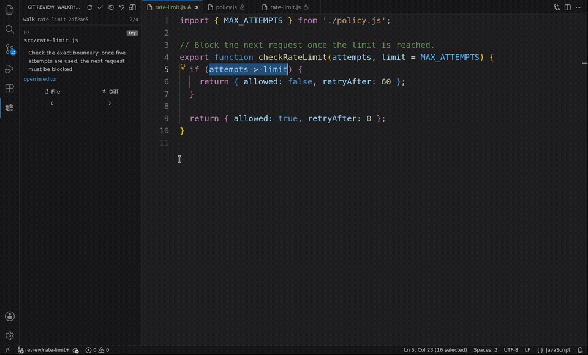

# git-review-workflow

> Review AI-written pull requests with a **guided reading order**: which file
> to read first, why it changed, and where to look closely. The author or a coding
> agent can commit a walkthrough alongside the change; you can also prepare your
> own for a PR that has none.
>
> Follow the whole change in your usual editor. The PR lands as one **staged,
> editable diff** you can run and test. When you finish, your corrections are
> extracted onto a separate branch. Re-review only what changed after an update.

[](LICENSE)
[](https://github.com/EzeVillo/git-review-workflow/releases)

**English** · [Español](README.es.md) · [Website](https://ezevillo.com/git-review-workflow/)

Interfaces: [VS Code extension](vscode-extension/README.md) · [JetBrains IDE plugin](jetbrains-plugin/README.md) · [Visual Studio extension](visualstudio-extension/README.md) · [terminal UI](tui/README.md)

Start from its VS Code, JetBrains, or Visual Studio panel, or use the terminal UI.
They guide the workflow while the [CLI](CLI.md) remains available for scripting
and advanced use.



**[Watch the 40-second IDE demo on the website](https://ezevillo.com/git-review-workflow/#demo-vscode)** — follow the reading order, fix the code,
run the tests, and take your correction to a separate branch.

[Read the guide: review a pull request locally](https://ezevillo.com/git-review-workflow/guides/review-pull-requests-locally/) — from the first staged diff to your own corrections.

---

A PR can touch many files without telling you where to start. A walkthrough
provides a reading order, a reason for each entry, and a heads-up on what needs
attention. Follow it in your editor, inspect the code beyond the diff, and leave
observations. You can use the author's walkthrough or prepare your own for the
review.

The entire PR stays available as **staged, uncommitted changes**. Run the tests
or edit the code when you need to check something. When you finish, any edits you
made are extracted onto a separate branch. A review can also finish without
code corrections. After an update, you can re-review only what changed.

## Reviewing what an agent wrote

You asked an agent for a feature. It came back with fourteen changed files and a
diff sorted alphabetically — the one order guaranteed to say nothing about the
change. Reviewing that means reconstructing, file by file, reasoning you never
saw in the first place.

As part of the same task, the agent can document its intended change in a
walkthrough: an order for the changed files, why each one matters, and what needs
attention. That explanation travels with the PR for you to check against the
implementation.

Then you open the review in one of the visual clients. It finds the walkthrough
automatically, shows the agent's heads-up on what is delicate, and takes you to
the first file with its explanation. Essential entries are marked as key and the
panel moves through the rest of the order. The whole PR stays staged and editable
throughout, so you can fix what you find inline and finish with your corrections
on a separate branch.

To make it automatic, put this instruction where your agent will read it — its
`AGENTS.md`, `CLAUDE.md`, or your prompt template:

> After making and committing the change, add a reading walkthrough to the PR.
> Order the changed files, write a one-line *why* for each one, include a heads-up
> with what is delicate, mark the few entries a reviewer must not skim, validate
> the walkthrough, and commit it alongside the code.

The result is a plain committed Markdown file, so it also just reads on GitHub
for anyone who never installs this. And you get the same benefit **without the
author on board**: on a PR that carries no walkthrough, the panel can help you
ask your own agent to generate one just for your review.

The reading order helps you navigate the change whether your review ends in
observations, a question for the author, or a correction. When you need to check
behavior, run the code in the same working tree and make an edit if useful.

## Why not just use my IDE's PR view?

git-review-workflow combines a **guided reading order and context** with a
complete, editable PR in your working tree. Follow the explanation, inspect the
implementation, and leave observations. If you make corrections, it separates
them from the author's work when you finish.

|                                 |    View the PR    | Guided order + why, per file  | Edit & run as working tree | Auto-extract your fixes | Incremental re-review | Editor-agnostic |
|---------------------------------|:-----------------:|:-----------------------------:|:--------------------------:|:-----------------------:|:---------------------------------:|:---------------:|
| **git-review-workflow**         |         ✅         |               ✅               |             ✅              |            ✅            |                 ✅                 |        ✅        |
| `gh pr checkout` / `glab`       | ⚠️ plain checkout |               ❌               |             ✅              |            ❌            |                 ❌                 |        ✅        |
| JetBrains *Review Pull Request* |         ✅         |               ❌               |       ⚠️ in-IDE only       |            ❌            |                 ❌                 |        ❌        |
| VS Code *GitHub PR* extension   |         ✅         |               ❌               |       ⚠️ in-IDE only       |            ❌            |                 ❌                 |        ❌        |
| GitHub / GitLab web UI          |         ✅         |               ❌               |             ❌              |            ❌            |            ⚠️ partial             |        ✅        |

The **reading walkthrough** adds an order and a reason for each entry to the
diff. The author (often an AI coding agent) can write it and commit it alongside
the PR. The reviewer panel detects it automatically and presents the files in
that order. You do not need the author or your team to adopt it first: the panel
can help you prepare your own reading order for a single review.

Because the PR is staged changes, tools that read a Git diff can inspect all of
it. You can also ask a coding agent to review that staged diff or help check a
specific observation in place.

When you decide to correct a typo, a name, or a behavior, edit it in your usual
tools. Automatic extraction keeps those corrections separate. You can also leave
an observation and let the author make the change. The guided review is useful
without editing code.

## Quick start

Every interface drives the same CLI, so install it first:

```sh
npm install -g git-review-workflow
```

Then choose the interface you want to work from:

| Interface | Start here |
|-----------|------------|
| **VS Code** | [Install the extension and open the git review panel](https://marketplace.visualstudio.com/items?itemName=EzeVillo.git-review-workflow) |
| **JetBrains IDEs** | [Install the plugin and open the git review tool window](https://plugins.jetbrains.com/plugin/33490-git-review-workflow) |
| **Visual Studio** | [Install the extension and open the Git Review panel](https://marketplace.visualstudio.com/items?itemName=EzeVillo.gitreviewworkflow) |
| **Terminal UI** | [Install and open the terminal interface](tui/README.md#getting-started) |

In a panel or the terminal UI, set the base branch once, then choose **Start a
review**. The interface asks which branch to review and how to read it. Edit and
run the staged change in your usual tools, then choose **Finish** to extract your
corrections onto a separate branch.

Prefer Homebrew, a native Windows (PowerShell) installer, or an install that
does not need Node? See [Installation](#installation). If you prefer scripting
or working directly from a shell, the [CLI reference](CLI.md) documents that
separate interface.

Comparisons offer Local comments only and retain them automatically when closed. Comment forms skip the destination selector when the CLI permits a single option.

Local notes stay private; Shared comments are prepared for the PR. Both documents
coexist, and the destination only applies to the new comment. If asked whether to
continue a previous review, choose whether to restore its Local notes or keep them
separate. Shared comes from the current branch in either case.

From the CLI, `git review comments add --document local` opens your Git editor
for a private observation; choose `--document shared` for prose intended for
the PR. Both documents remain editable Markdown outside the working tree while
reviewing. `finish` leaves changed Shared comments as `.review/comments.md` on
the output branch, staged together with your code edits and ready to commit.
The private Shared preparation is then removed. Save/Continue keeps it until
Finish, including deleted comments. Undo returns it to the review; Cancel
discards that pass and preserves the branch's original comments. Outside a
review, Comments sits between Walkthrough and Compare and reads Shared from
the current branch, including on a fresh clone. Comments inherited from a merged
PR are not copied into a new review. Adding comments requires an active session.
Local comments stay private. **Copy path** copies the absolute path of an existing Local
document from its panel row, including retained results. See [review comments](CLI.md#review-comments) for renumbering,
historical diffs and keeping comparison comments locally.

IDE comment forms offer the exact selected code fragment, the current file, and General, defaulting to the most specific available scope. You can change scope before saving. Existing Local and Shared preparations appear separately and can be deleted during the review. Local results remain editable after Finish.

The comment form labels the text field explicitly. The Diff browser shows a
compact location and a one-line preview, with `…` when the comment is shortened.
The complete comment scrolls below; original revision IDs are folded under
Details, while warnings about unsaved captures stay visible. Diffs open inside
the IDE, with the comment still accessible. In the terminal, `d` toggles Details
and Tab returns to the complete comment. Selected lines are marked on the
recorded version. Local results and pending Shared preparations can also be
deleted after Finish; delivered Shared is read from `.review/comments.md`.

The comment browser also lets you delete an individual comment without changing
the others or their numbers. General comments do not offer a diff.

## Installation

The visual clients share a small command-line foundation. The
[Quick start](#quick-start) above already covers the npm install; expand below
for Homebrew, the native Windows installer, or a no-Node option.

<details>
<summary>Installation methods (npm, Homebrew, Windows, one-line, PATH)</summary>

Pick whichever method matches your setup. The package-manager options are the
easiest and **set up your `PATH` for you**.

### npm (recommended)

If you have [Node.js](https://nodejs.org), this is the one-command install. It
puts `git review` on your `PATH` for you and works on Linux, macOS and Windows
(on Windows the commands still run under Git Bash):

```sh
npm install -g git-review-workflow
```

Update with `npm install -g git-review-workflow@latest`; uninstall with
`npm uninstall -g git-review-workflow`. Tab completion is set up the same way as
the other non-Homebrew installs — see the note below.

### Homebrew (macOS / Linux)

```sh
brew tap EzeVillo/git-review-workflow https://github.com/EzeVillo/git-review-workflow
brew install EzeVillo/git-review-workflow/git-review-workflow
```

Tab completion is configured automatically. To update to the latest release:
`brew upgrade git-review-workflow`.

### Windows (PowerShell)

You still need [Git for Windows](https://gitforwindows.org), which provides the
shell these commands run in. Open PowerShell and run:

```powershell
irm https://raw.githubusercontent.com/EzeVillo/git-review-workflow/main/web-install.ps1 | iex
```

This installs the command into `~\.local\bin` and adds that folder to your user
`PATH` automatically. Open a new terminal after it finishes. Re-run to update; to
uninstall:

```powershell
irm https://raw.githubusercontent.com/EzeVillo/git-review-workflow/main/web-uninstall.ps1 | iex
```

(If you have Node, `npm install -g git-review-workflow` works on Windows too —
the commands still run under Git Bash either way.)

### One-line install (Linux, macOS, WSL, Git Bash)

No package manager? This downloads the command and installs it into
`~/.local/bin` — you don't need to clone the project first:

```sh
curl -fsSL https://raw.githubusercontent.com/EzeVillo/git-review-workflow/main/web-install.sh | sh
```

Re-run to update (always installs the latest release). To uninstall (pass the
same `PREFIX` if you overrode it):

```sh
curl -fsSL https://raw.githubusercontent.com/EzeVillo/git-review-workflow/main/web-uninstall.sh | sh
```

<details>
<summary>From a downloaded copy</summary>

If you cloned or downloaded the project, open its folder in a terminal and run:

```sh
./install.sh
```

This installs the `git review` dispatcher into `~/.local/bin` (change the
location with `PREFIX=/usr/local/bin ./install.sh`). The verbs travel beside it
as private helpers, not as separate commands on your `PATH`. Undo it any time
with `./uninstall.sh`. To update, just `git pull` inside the repo — the symlink
picks up changes automatically.
</details>

<details>
<summary>"command not found" — adding <code>~/.local/bin</code> to your PATH</summary>

Your `PATH` is the list of folders your terminal searches when you type a
command. Homebrew, npm and the PowerShell installer add their folder for you. The
one-line and manual installs use `~/.local/bin`, which is already on the `PATH`
on most systems. If it isn't, the installer prints a note — add it **once** by
pasting one line into your shell's config file:

| If your terminal uses…            | Add this line to the file…       | The line to add                        |
|-----------------------------------|----------------------------------|----------------------------------------|
| **bash**                          | `~/.bashrc`                      | `export PATH="$HOME/.local/bin:$PATH"` |
| **zsh** (default on recent macOS) | `~/.zshrc`                       | `export PATH="$HOME/.local/bin:$PATH"` |
| **fish**                          | *(no file — just run this once)* | `fish_add_path ~/.local/bin`           |

Not sure which one you use? Run `echo $0`. After editing the file, **open a new
terminal** (or `source` the file). Your visual client can then find the CLI.
</details>

<details>
<summary>Git Bash on Windows — SSL error during install?</summary>

If you see `schannel: next InitializeSecurityContext failed` or a
`revocation check` message, your Git for Windows is using the Windows SSL
backend. Fix it once, then re-run the installer:

```sh
git config --global http.sslBackend openssl
```

</details>

</details>

## CLI reference

The panels and terminal UI cover the normal workflow. For every command, flag,
recovery path and advanced flow, see the [complete CLI reference](CLI.md).

## Requirements

- Git 2.23+. Git 2.38+ is recommended for the most accurate comparison when a
  PR merges content from its base branch.
- A configured Git remote.
- A POSIX shell. On Linux and macOS this is the default. On Windows the commands
  run under Git Bash or WSL, not in `cmd.exe` or PowerShell.

## Contributing

Bug reports, fixes and ideas are welcome. See [CONTRIBUTING.md](CONTRIBUTING.md)
for how to run the tests and the release process.

## License

[MIT](LICENSE) © EzeVillo
